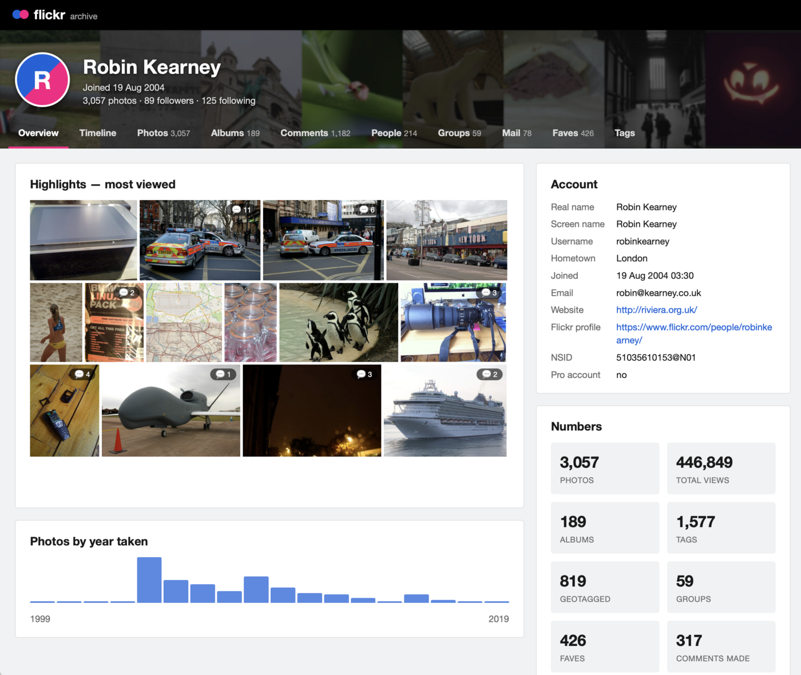
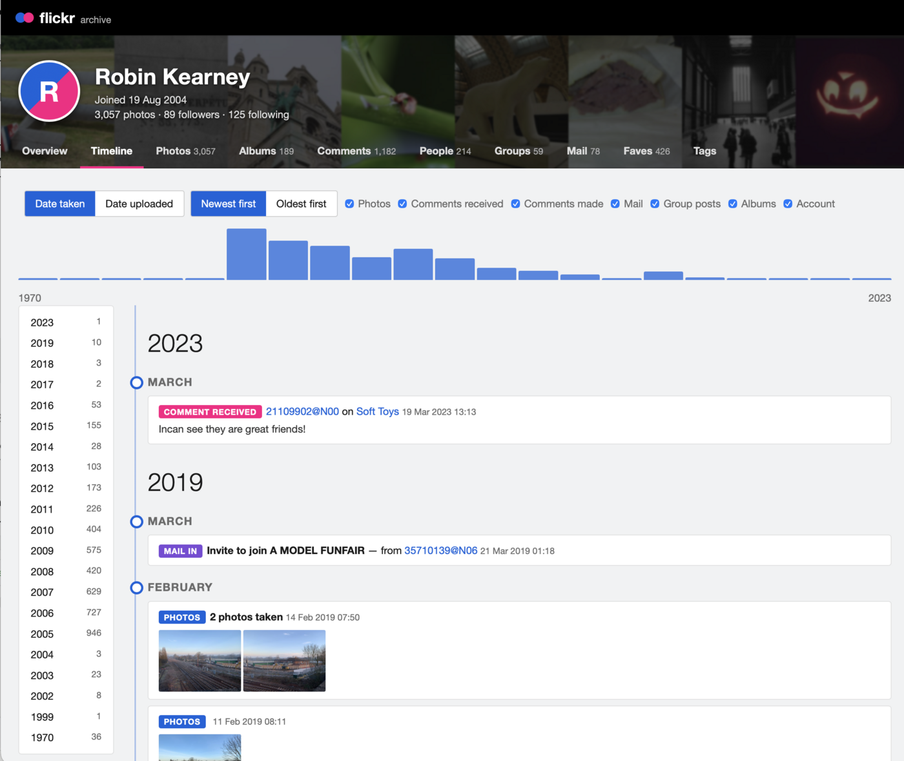
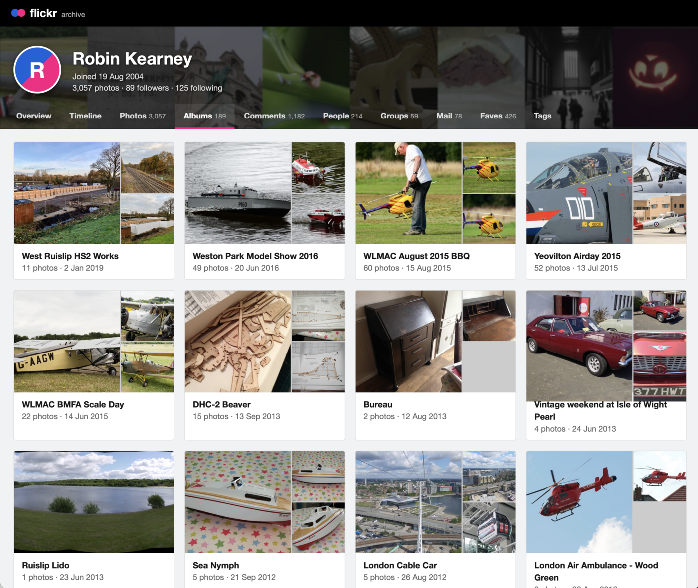

# flickr-export-browser

A small self-hosted web page for browsing **your own** downloaded Flickr export at home: photos, timeline, albums, comments, contacts, groups, mail, faves and tags.

> **Not affiliated with Flickr.** This is an independent hobby project for browsing your own export at home. It is not a Flickr clone, doesn't talk to Flickr, and isn't meant for the public internet. "Flickr" is a trademark of its owner.

## Screenshots







## Quick start

1. Request your data from Flickr. You'll get a whole bunch of zip files. Extract **all** of them into one folder. The folder can be named anything you like, and its name is what shows up in the account picker, e.g. `robin/`.

   If you have more than one person's export, give each their own folder and put them side by side:

   ```
   flickr-backup/
     robin/    <- all of Robin's zips extracted here
     ben/
     bill/
     fred/
   ```

   Each folder ends up containing files like `account_profile.json`, `albums.json`, `photo_<id>.json` and the photos themselves.

2. Point the app at the parent folder (`flickr-backup/` above) and start it:

   ```sh
   cp .env.example .env        # set DATA_DIR=/path/to/flickr-backup
   docker compose pull         # fetch the prebuilt image
   docker compose up -d
   ```

   Prefer to build it yourself? Use `docker compose up -d --build` instead.

3. Open <http://localhost:8080>.

With one folder you go straight to that account; with several you get a picker. Your export is mounted read-only and is never changed.

## Container image

Tagged releases publish a multi-arch (amd64 and arm64) image to the GitHub Container Registry:

```sh
docker pull ghcr.io/rk295/flickr-export-browser:latest
```

See the [releases page](../../releases) for versions. Each release is built by `.github/workflows/release.yaml` when a `v*` tag is pushed.

## Using it

- **Search:** the box in the top bar (press `/`) searches photos, albums, comments, mail, group posts and people.
- **Photos:** sort, and filter by year, album, comments or location. Click a photo for the full-size view and use the arrow keys to move between photos.
- **Timeline:** photos, comments, mail, group posts and albums by date, by date taken or date uploaded.
- **Everything else:** comments made and received, contacts and followers, groups, Flickr mail, faves and tags.
- **Several accounts:** a contact or commenter who is also one of your accounts links through to it.

The first start with a large export takes a while to make thumbnails. Progress shows in the top bar and you can browse meanwhile.

## Adding accounts

Drop another export folder into the data directory. It appears within a minute, with no restart. Exports split into parts (`*_part001.json`) are merged automatically.

## Configuration

| Variable    | Default  | Purpose                                      |
| ----------- | -------- | -------------------------------------------- |
| `DATA_DIR`  | `./data` | Folder containing one sub-folder per account |
| `HTTP_PORT` | `8080`   | Port to publish                              |

Thumbnails are cached in `./cache`. You can delete it at any time; thumbnails are rebuilt on demand.

**Behind a reverse proxy:** copy `docker-compose.override.yml.example` to `docker-compose.override.yml` and edit the hostname and labels. Compose merges it automatically.

There is no login. Run it on a trusted network only.

## Development

```sh
npm ci
DATA_DIR=/path/to/flickr-backup CACHE_DIR=/tmp/flickr-cache PORT=8080 npm start
npm run lint
```

CI runs ESLint, a syntax check and a Docker build, on both GitHub Actions and Gitea Actions (`.github/workflows/`). Architecture notes for contributors and coding agents are in [AGENTS.md](AGENTS.md).

## License

[MIT](LICENSE)
